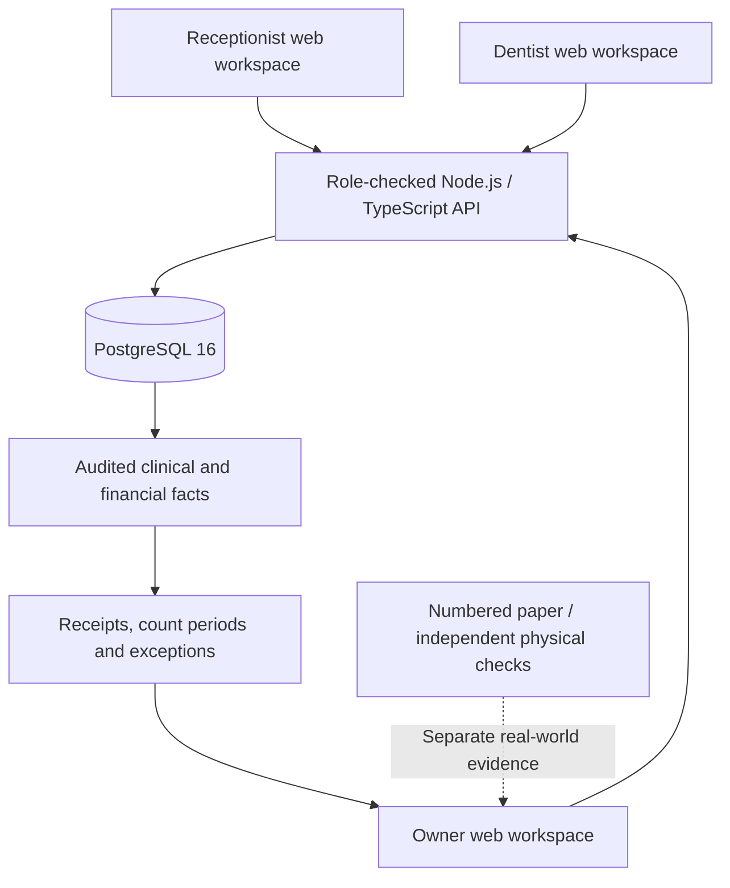

# 🦷 EZZ Clinic

### A calmer clinic. A clearer record. Money that has to make sense.

**EZZ Clinic is a bilingual, role-based dental-clinic management application being developed for private practices in Tunisia.** It connects the front desk, dentist, and owner without making the dentist spend the day in software—or expecting patients to own a smartphone.

The idea is simple: **appointments become care, care becomes a recorded charge, payments get receipts, and financial claims can be checked against independent evidence.**

**[See the app](#a-look-inside) · [Follow a clinic day](#one-visit-three-perspectives) · [Run it locally](#run-the-fictional-app) · [Explore the architecture](#how-it-works-under-the-hood) · [What is still missing?](#development-status--roadmap)**

> [!CAUTION]
> **Development project · fictional data only. Not a clinical, fiscal, CNAM, or production system.**
> Do not enter real patient information, take real payments, issue legally valid receipts, or expose the fixture server to the internet. Code and automated tests exist; deployment, professional validation, privacy compliance, physical controls, and founder release approval are separate, **unfinished** gates. No software can guarantee zero theft.

## Why build this?

Imagine a busy dental clinic: a receptionist manages walk-ins and calls, a dentist finishes treatments between patients, and the owner reconciles the day's cash later. A booking calendar alone doesn't answer the questions that matter:

- **Was this patient the right person?** Similar names and incomplete files should not silently open the wrong chart.
- **Was treatment actually performed?** Only an authorized dentist—not a receptionist's claim—can establish the clinical work and fee.
- **Was a payment recorded once?** A lost connection or repeated click must not create a second payment.
- **Does recorded money agree with independent evidence?** A staff-entered card claim is not a bank settlement; a recorded cash payment is not a physical cash count.
- **What happens during an outage?** Patients still arrive; numbered paper records must be reconciled after connectivity returns.

The goal is **less administrative friction and more accountable evidence**, not an accusation engine. An event that was never recorded may remain invisible to software. Receipts, independent counts, real bank evidence, and human checks still matter.

## A look inside

These are **actual Chromium screenshots** of the fictional development app, not AI-generated future-screen concepts. They illustrate tested snapshots; an image is not proof of a production release.

| Receptionist's desktop — French | Mobile agenda — Arabic, right-to-left |
| --- | --- |
|  |  |

| Recorded checkout — French | Recorded checkout — Arabic |
| --- | --- |
|  |  |

The design direction is **clean, calm, and task-first**: pale surfaces, deep teal accents, readable information, and meaningful warnings. Arabic layout, keyboard operation, zoom, printing, and real clinic usability require continuing validation.

More evidence: [receptionist screenshots and real-API tests](docs/testing/SPRINT2-FRONTEND.md) · [checkout screenshots and tests](docs/testing/SPRINT3B-CHECKOUT.md) · [role-based design direction](docs/design/role-workspaces-v1.md).

## One visit, three perspectives

### 1. Receptionist — keep the day moving

Find or register a patient, review the clinic's day board, book an appointment, record arrival, and work through an authorized checkout. Ambiguous identity, overlapping bookings, permissions, connectivity failures, and uncertain payments should produce **visible decisions**, not fake success messages.

The intended reception workflow supports people who prefer **French, Arabic, paper, or face-to-face communication**. No patient QR code, kiosk, app download, or smartphone is required.

### 2. Dentist — confirm what really happened

The dentist works under their own authenticated identity. Confirmed care and fees are distinguished from plans, notes, and estimates. Clinical records, corrections, alerts, and author identity are handled by backend permissions and dedicated development workflows. **A booking does not automatically mean treatment was performed.**

The design objective is a small number of meaningful clinical actions—not making the dentist a second receptionist.

### 3. Owner — see the evidence, not just a total

The owner needs to understand receipts, cash-drawer periods, discounts, returns, exceptions, and what is still unverified. A **blind count** does not display the expected cash before the count is entered. Recorded card payments remain clearly distinct from imported statement evidence and actual provider confirmation.

Example: if the system records **20,000 TND** in cash but an independently counted drawer contains **17,000 TND**, it can show a **3,000 TND discrepancy**. That is a reconciliation signal, **not proof of theft or proof of who held the cash**.

### What the patient sees

A person—not a phone—is at the center. Printed appointment information, numbered receipts, and a documented paper process remain important. **Printing a document is not the same as proving it reached the right person.**

## What's in the development build?

The distinction below matters: **present in merged source** does not mean **fully accessible in every screen** or **approved for real-world use**.

| Area | What the repository contains | What that does *not* establish |
| --- | --- | --- |
| **Reception & agenda** | Staff sessions, patient search/registration, clinic day board, visits, arrival/status workflows; French/Arabic web UI. | A complete real-clinic workflow or clinical acceptance. |
| **Clinical work** | Authenticated dentist care, clinical records and review-oriented backend/frontend modules. | Qualified dentist validation or complete imaging, consent, and prescription workflows. |
| **Payments & receipts** | Integer-millime amounts, transactional recording, idempotency, receipt numbering, recovery and print/reprint paths. | A real payment processor, legally certified fiscal receipts, or confirmed paper delivery. |
| **Financial oversight** | Cash periods and blind counts, audit/integrity evidence, review and exceptions; owner-oriented modules. | Proof of physical custody, detection of every unrecorded payment, or independent bank settlement. |
| **Continuity & CNAM** | Fictional paper-outage and CNAM paper-dossier backend building blocks. | Official CNAM eligibility, tariffs, form acceptance, reimbursement, or a completed staff drill. |
| **Security & testing** | Role checks, tenant isolation, migration guards, PostgreSQL tests, real-API browser tests and CI workflows. | Production identity, hosting, backup custody, independent penetration testing, or release authorization. |

**In-progress work is separate from merged functionality.** At the **November 1, 2026** repository snapshot, these were *open draft PRs*, not shipped features:

- [#44 — private fictional-data phone preview](https://github.com/EzzeddineAlimi/ezz-clinic-app/pull/44): authenticated mobile/browser acceptance still required. See the [private Codespaces guide](docs/operations/CODESPACES-FICTIONAL-PREVIEW.md); the port must remain **Private** and all data fictional.
- [#107 — large-print French/Arabic appointment card](https://github.com/EzzeddineAlimi/ezz-clinic-app/pull/107): independent current-head UX/print and physical handoff gates remain.
- [#108 — receptionist enquiry API](https://github.com/EzzeddineAlimi/ezz-clinic-app/pull/108) and dependent [#109 — enquiry UI](https://github.com/EzzeddineAlimi/ezz-clinic-app/pull/109): founder privacy, retention and review decisions remain open.
- [#110 — clinic hours and manual closure days](https://github.com/EzzeddineAlimi/ezz-clinic-app/pull/110): independent backend/security review remains.

**Current state changes.** See the [open PRs](https://github.com/EzzeddineAlimi/ezz-clinic-app/pulls), [issues](https://github.com/EzzeddineAlimi/ezz-clinic-app/issues), and [GitHub Actions](https://github.com/EzzeddineAlimi/ezz-clinic-app/actions) for current heads and evidence—not this dated snapshot.

## How it works under the hood



A **modular monolith** keeps appointment, care, payment, receipt, and audit operations together where database transactions matter. It is deliberately simpler to operate than a network of small services.

| Layer | Current development choice |
| --- | --- |
| Web | **React 19 + TypeScript + Vite**, French/Arabic and RTL support |
| API | **Node.js 22 + TypeScript**, role-scoped modular application |
| Database | **PostgreSQL 16**, transactions, row-level security and audited changes |
| Contracts | Documented routes, generated [OpenAPI](docs/api/openapi.json) and [permissions](docs/security/permission-matrix.md) |
| Tests | Node test runner, PostgreSQL 16 integration suites, Playwright real-API browser tests and selected accessibility checks |
| Operations | Local disposable fictional environment; **no approved production hosting** |

Three design principles run through the code:

1. **The server is the authority.** A hidden UI button is not access control. Session-derived roles and clinic boundaries are checked in the API and database.
2. **Money is exact and recoverable.** Amounts use integer **millimes** (1 TND = 1,000 millimes). Writes use idempotency and database transactions so retries do not automatically duplicate a charge or receipt.
3. **Recorded is not verified.** The UI must not upgrade a receptionist's statement into physical-cash, bank, clinician, or legal proof. Audit logs can support investigation, but they cannot replace independent evidence.

Read further: [architecture](docs/architecture/architecture.md) · [API endpoints](docs/api/endpoints.md) · [engineering standards](docs/engineering/standards.md) · [security status and open gaps](docs/security/security-status.md).

## Run the fictional app

> [!IMPORTANT]
> **Only on a trusted development machine using disposable fictional data.** The local fixture is intentionally not a hardened public service. Do not point its administrative database URL at a real clinic.

**Prerequisites:** npm, PostgreSQL **16 server binaries**, and **Node.js 22** (the supported development range in both package manifests is `>=22.18 <23`; `backend/.nvmrc` pins `22.23.4`). A modern browser can open the UI. Node 24/26 CI is forward-compatibility testing, **not** a change in the supported runtime.

**1. Install the locked dependencies** from the repository root:

```bash
npm --prefix backend ci --ignore-scripts --no-audit --no-fund
npm --prefix frontend ci --ignore-scripts --no-audit --no-fund
```

**2. Terminal A — start disposable PostgreSQL and the real API:**

```bash
cd backend
eval "$(bash scripts/dev-pg16.sh start)"
node scripts/dev-web.ts
```

The bootstrap creates its own disposable application database and seeds fictional clinic records through real API calls. The API listens on `127.0.0.1:4180`. Keep this terminal running.

**3. Terminal B — start the browser app**, from the repository root:

```bash
npm --prefix frontend run dev
```

Open **http://127.0.0.1:5173**. Use the local test accounts:

| Local sign-in field | Fictional value |
| --- | --- |
| Clinic | `web-fictional` |
| Account | `desk`, `dentist`, `owner`, or `assistant` |
| Password | `fictional-pass-123` |

These are **public fixture credentials** for a throwaway local database, not credentials for any hosted clinic. The assistant account has read-only permissions. Stop the application/API with Ctrl-C; when finished, stop the disposable PostgreSQL cluster with:

```bash
bash backend/scripts/dev-pg16.sh stop
```

If you encounter an environment issue, follow the [frontend run guide](frontend/README.md), [backend guide](backend/README.md), and [development environment checks](docs/engineering/dev-environment.md). Those are development documents, not production setup instructions.

## Test what matters

The test strategy emphasizes **real database and API behavior**, not mocked green screens.

```bash
# Start the disposable PostgreSQL 16 cluster and export EZZ_TEST_ADMIN_URL first.

npm --prefix backend run typecheck
npm --prefix backend test
npm --prefix backend run test:dist

npm --prefix frontend test
npm --prefix frontend run build
npm --prefix frontend run test:e2e
```

For Playwright, leave the disposable PG16 cluster running but **stop any manually started servers on ports 4180/5173**; the test harness starts its own real API and app preview. Browser setup may require `cd frontend && npm exec playwright install chromium`.

Key test themes include wrong-clinic access, role denials, duplicate writes, concurrent receipt issuance, lost responses, financial-state reconciliation, clinic-local time, and keyboard/RTL browser behavior. Consult the [test results matrix](docs/testing/results-matrix.md) and individual [sprint test evidence](docs/testing/SPRINT2-FRONTEND.md) for *recorded versions and environments*.

> **A green CI run proves only the checks it executed at that exact commit.** It does not prove real-world clinical safety, legal compliance, physical cash custody, or the acceptance of an entire V1 feature.

## Development status & roadmap

The founder-approved product catalogue contains **61 V1 feature groups**, **43 later-phase groups**, and **4 excluded groups**. This is a scope decision—not a list of features already delivered. At the last independently recorded V1 acceptance snapshot, **0 of 61 groups had final acceptance**.

The next milestones are intentionally evidence-gated:

1. **Finish integration safely.** Review outstanding draft PRs against their *current* head commit; avoid duplicate implementation and respect PR ancestry.
2. **Complete usable role workflows.** Validate receptionist, dentist and owner experiences on desktop/mobile, French/Arabic, keyboard/zoom, errors, and paper printing.
3. **Close financial and clinical evidence gaps.** Independent cash custody, bank/card reconciliation, patient receipt handoff, clinician review and actual staff recovery drills.
4. **Verify Tunisian requirements before real use.** CNAM forms/eligibility/tariffs, clinical record obligations, privacy/retention, fiscal documents, identity and hosting decisions require current authoritative sources and qualified local review.
5. **Pass independent acceptance and explicit release authorization.** No deployment because a demo looked good or CI passed.

Track the release gates in [V1 acceptance issue #69](https://github.com/EzzeddineAlimi/ezz-clinic-app/issues/69), [security/hosting issue #72](https://github.com/EzzeddineAlimi/ezz-clinic-app/issues/72), [governance issue #68](https://github.com/EzzeddineAlimi/ezz-clinic-app/issues/68), and [UX gate #58](https://github.com/EzzeddineAlimi/ezz-clinic-app/issues/58).

## Find your way around

| Start with | If you're looking for… |
| --- | --- |
| [`frontend/`](frontend/) | Web UI, screen states, browser tests and local instructions |
| [`backend/`](backend/) | TypeScript API, modules, migrations, test fixtures and backend tests |
| [`docs/INDEX.md`](docs/INDEX.md) | The **documentation authority map**: which source answers which question |
| [`docs/product/`](docs/product/) | Visit flow, owner review, settings, printing and product behavior |
| [`docs/clinical-domain/`](docs/clinical-domain/) | Dental workflow contracts and their limitations |
| [`docs/api/`](docs/api/) | Generated API contract, errors and permission behavior |
| [`docs/architecture/`](docs/architecture/) | Architectural decisions and integrity model |
| [`docs/security/`](docs/security/) | Threats, roles, production security gaps |
| [`docs/testing/`](docs/testing/) | Executed test evidence and acceptance boundaries |
| [`docs/design/`](docs/design/) | Role-first design system, UX review and accessibility |
| [`src/`](src/) and [`test/`](test/) | **Historical v0.1 prototype**, separate from the active React/PostgreSQL application |

## Contributing and reviewing

This is an **active, review-gated development repository**. Start with [`AGENTS.md`](AGENTS.md), [engineering standards](docs/engineering/standards.md), and the [documentation index](docs/INDEX.md).

- **Before editing:** inspect current `main`, open PRs, the exact source, and the specific accepted requirement. Prefer one owner and one minimal, tested change over competing branches.
- **When fixing a bug:** establish a cause from logs or a failing regression, then make the smallest change that passes the test.
- **When changing a workflow:** update its matching contract/docs, bilingual/error states and relevant regression tests—not unrelated files.
- **Before proposing integration:** provide the exact commit SHA, checks actually executed (including skips), and independent reviewer findings. Clinical, privacy, cash and payment controls require more than the implementer's own sign-off.
- **Never submit:** real patient details, real payment credentials, secrets, unsupported regulatory claims, invented screenshots, or unverified claims of a passing test.

### The north star

**A receptionist can keep the clinic moving. A dentist can focus on patients. An owner can understand what the records prove—and what they don't.**

That is the product we're working toward. **It is not yet a production-ready clinic system.**
