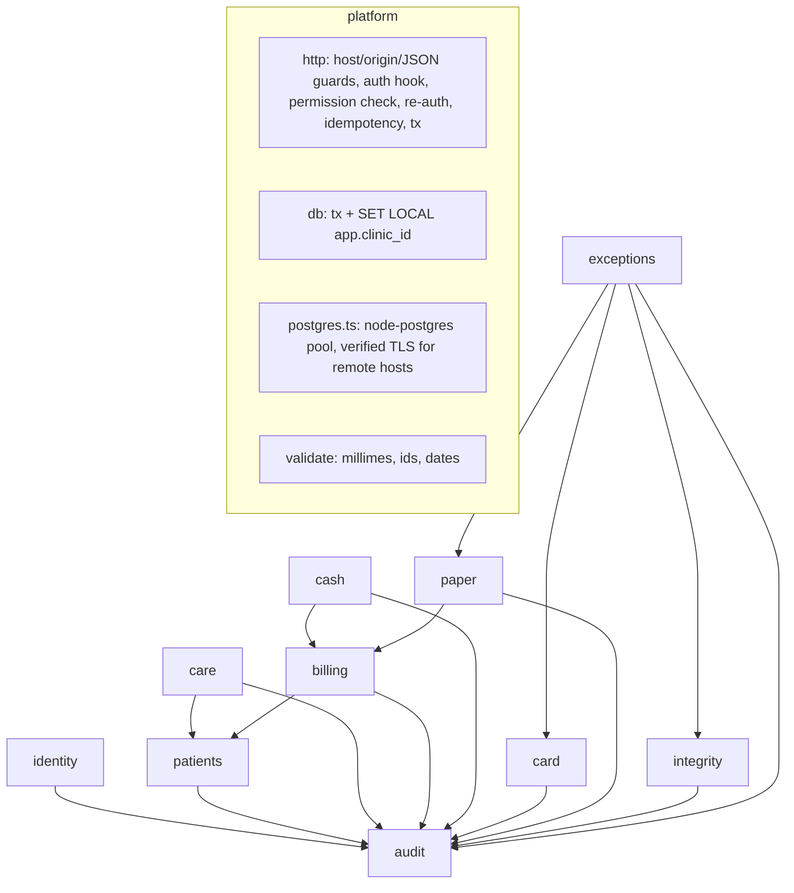

# EZZ Clinic — v0.2 production-oriented architecture (Mission A)

Status: ARCHITECTURE DRAFT by Claude Opus 5.5, 2026-10-28. Implemented for **fictional data only** in `backend/` (80/80 synthetic tests pass on PostgreSQL 16). **No final stack, hosting, PSP or legal decision is made here** — those stay founder-gated (COMMAND R36/R38/R42). Labels: DECIDED-FOR-DEV (reversible default used in code), CANDIDATE, OPEN, UNVERIFIED.

Related: `decisions.md` (ADRs), `module-map.md`, `../database/schema.md`, `../api/api-v1.md`, `../security/*`, `../testing/results-matrix.md`, `../operations/privacy-compliance-and-operational-risk.md`, `../clinical-domain/clinical-requirements.md`.

---

## 0. Design goals in priority order

1. **Independent evidence over trust in the desk.** Every money fact is either (a) authored by the right person (dentist for care/fee, owner for refunds/voids/movements/statement imports), or (b) checked against a root the receptionist does not control (owner blind count, owner-imported statement, numbered paper book held by the dentist, owner-held audit checkpoint). Wording is always about evidence, never accusations. Zero theft is never claimed (CH-002: an event never entered is invisible).
2. **Exact money**: integer millimes end to end (DB `bigint`, JSON integers, exact string parser for UI). No floats, no rounding.
3. **Durability and atomicity**: one request = one database transaction containing the effect, its receipt number, its audit event and its idempotency record.
4. **Minimal dentist effort**: one act per visit (confirm care) and exception-only review; the owner does the periodic checks.
5. **Elderly / no-phone first**: paper receipts and numbered paper books are primary paths, never fallbacks that lose information.
6. **Small operational surface**: one deployable, one database, one language; nothing a clinic must operate itself.

## 1. Modular monolith vs alternatives — DECIDED-FOR-DEV: modular monolith

| Option | For | Against | Verdict |
|---|---|---|---|
| **Modular monolith** (one Node process, enforced module boundaries, one PostgreSQL) | One transaction can cover payment + receipt + audit + idempotency; one backup unit; simplest ops; R34 P1, C-141 L2, M-242 PASS WITH CAVEAT | Boundaries erode without enforcement | **Chosen**; boundaries enforced by `test/architecture.test.ts` (ARCH-1/2) |
| Microservices | Independent scaling/teams | Distributed transactions for money, more auth boundaries to miss, no clinic IT to run it | Rejected for v1 |
| Local-first desktop (SQLite per clinic + sync) | Works offline; data stays in clinic | SQLite has no DB roles (desk OS user can edit the file), multi-device sync creates receipt/count conflicts, backups depend on clinic hygiene | **OPEN alternative** (GEM-REV-003 dissent preserved); decide with the 4-hour/20-visit drill (CH-010) |
| Hybrid: cloud system of record + read-only local cache + numbered paper during outage | Strong evidence model; outage continuity via paper | Cannot write electronically during an outage | **Current default** (M-242 "numbered paper primary") |

## 2. Module boundaries and ownership

| Module | Owns tables | Responsibility | May read |
|---|---|---|---|
| identity | staff, staff_roles, sessions, login_attempts, security_denials, idempotency_records | accounts, roles, sessions, permission matrix, step-up re-auth, lockout, idempotency | — |
| audit | audit_heads, audit_events, audit_checkpoints | hash chain, owner checkpoints, verification | — |
| patients | patient_file_counters, patients, visits | synthetic patient register, visit lifecycle | — |
| care | care_items | dentist-confirmed care & fee, corrections, free care | visits |
| billing | receipt_counters, payments, payment_allocations, adjustments, receipts, receipt_prints, view visit_balances | payments, gap-free receipts, discounts/refunds/voids | care_items |
| cash | cash_drawers, cash_periods, cash_movements, cash_counts | blind counts, periods, float, movements, close/carry-forward | payments, adjustments |
| card | clinic_card_settings, provider_settlement_events, statement_imports, statement_lines, card_matches | evidence tiers, statement import, matching | payments, adjustments |
| paper | paper_books, paper_slip_entries | outage books, slip re-entry, sequence reconciliation | — (writes payments via billing) |
| integrity | — | missing-record & tamper detection | all |
| exceptions | exception_resolutions | owner exception list, per-item resolution | all |

Rule: a module writes only its own tables, except through another module's exported function (e.g., paper → `billing.recordPayment`). Cross-module reads are SQL reads inside the same transaction. Platform never imports modules (ARCH-2).

## 3. Database architecture and transaction guarantees — DECIDED-FOR-DEV: PostgreSQL 16 (CANDIDATE for production)

- **One transaction per request** (`Db.tx`). Isolation READ COMMITTED + explicit row locks on the aggregate being changed:
  - payments/refunds/voids: `visits` row `FOR UPDATE` → no overpayment under concurrency (T-RACE-1);
  - receipt numbers: per-clinic `receipt_counters` row `FOR UPDATE` → gap-free and rolled back with the transaction (T-TX-1). PostgreSQL sequences are deliberately **not** used (they are not gap-free; C-139);
  - audit: per-clinic `audit_heads` row `FOR UPDATE` → strict sequence;
  - cash: writes take `FOR SHARE` on the open period; a count takes `FOR UPDATE` and uses `clock_timestamp()` after the lock, so no payment straddles a count cut-off (T-CASH-CONC).
- **Append-only evidence tables** (payments, allocations, adjustments, receipts, care_items, cash_counts/movements, statement_*, card_matches, paper_*, audit_*): trigger `ezz_forbid_mutation` (SQLSTATE `EZ001`) on UPDATE/DELETE/TRUNCATE **and** no UPDATE/DELETE privilege for `ezz_app` (T-EVT-4/5).
- **Computed, never stored balances** (`visit_balances` view, `security_invoker`), so balances cannot drift from facts.
- **Constraints as the last line of defence**: CHECKs for money ranges, FDI tooth validity, tier rules (`PROVIDER_VERIFIED` requires a provider event), void-has-no-amount, one effective paper entry per slip, one void per payment, one statement line per claim.

## 4. Multi-clinic isolation

Three independent layers (T-ISO-1/2/3, T-CARE-6):
1. **API**: clinic comes only from the session; foreign ids return 404 (no existence leak).
2. **PostgreSQL RLS** (`ENABLE` + `FORCE`) on every tenant table, policy `clinic_id = current_setting('app.clinic_id')`, set with `SET LOCAL` per transaction. The API role has no `BYPASSRLS`.
3. **Composite foreign keys** `(clinic_id, id)` so a row of clinic B cannot reference a row of clinic A even for the schema owner.
Known exceptions (documented): `clinics`, `sessions`, `login_attempts` are read before the clinic is known and are not under RLS.

## 5. Authentication and authorisation

- Per-person accounts (no shared desk PIN), scrypt password hashes, opaque 256-bit bearer tokens stored as SHA-256, 12 h absolute / 30 min idle expiry (ASSUMPTIONS), lockout after 5 failures in 15 min, **step-up re-auth within 5 min** for owner-sensitive actions (statement import, card match, refunds/voids, cash movements/close, staff changes, checkpoints).
- **Single permission matrix** in code (`identity.PERMISSIONS`), generated into `docs/security/permission-matrix.md` with a drift test (ARCH-5). Body-supplied identity is ignored (T-CARE-4). Denials increment a rate-limited counter the owner sees.
- Employee departure: deactivate → all sessions revoked in the same transaction (T-SESS-1). No self-service recovery: owner resets staff passwords; **owner recovery needs DB-owner access via CLI** (OPEN: sealed recovery code / second owner — see ops doc).
- OPEN for production: MFA for owner, chairside dentist authentication (glove-friendly), device binding. No identity provider is chosen.

## 6. Financial event model

Facts (immutable rows) → derived views. Money flows:

| Fact | Author | Effect on visit balance | Effect on expected drawer cash | Receipt |
|---|---|---|---|---|
| care_items CARE / CORRECTION | DENTIST | + fee / ± delta | — | — |
| payments (DESK, CASH/CARD) | any desk-capable role | − amount | + amount if CASH | R-nnnnnn |
| payments (PAPER_OUTAGE) | entry by desk/dentist/owner from custodian's book | − amount | + amount if CASH | the paper slip P-nnn |
| adjustments DISCOUNT / WRITE_OFF | DENTIST or OWNER | − amount | — | — |
| adjustments REFUND | OWNER (+re-auth), only if credit exists | + amount | − amount if CASH | R (REFUND) |
| adjustments PAYMENT_VOID | OWNER (+re-auth) | + payment amount | − amount if CASH | R (VOID) |
| cash_movements | OWNER (+re-auth) | — | ± (top-up / withdrawal / deposit / petty) | — |

**The 100 DT / 70 DT scenario**: if the desk records 100,000 while the patient handed over 70,000, the patient-held receipt shows 100,000 and the owner's blind count is 30,000 short (FRAUD-SCENARIO-70-CASH). If the desk records **less** than paid, the drawer balances and only the patient-held receipt / visible balance can expose it (Mode B residual).

## 7. Tamper evidence and owner-held checkpoints

`hash(n) = sha256(prev_hash(n) + "\n" + canonical_json(n))`, one chain per clinic, written in the business transaction. Verification recomputes the chain and reports the first bad sequence (T-EVT-2). **Internal hashes do not stop a superuser rebuilding the chain** (CH-008): the independent control is the owner checkpoint line (`EZZ-CHECKPOINT <clinic> seq=<n> hash=<h>`) printed or copied outside the system; verification with that anchor detects tail truncation (T-EVT-3) and an older backup restored over newer data (T-BKP-1). Integrity check adds cross-table detection: receipt gaps, payments without receipts, rows without audit events, audited payments that disappeared (T-MISS-1). Exposure window = time between owner checkpoints (the exception list nags after 7 days).

OPEN: signed checkpoints with an owner-held key; external timestamping; automatic off-site checkpoint delivery (needs a channel decision and privacy review).

## 8. Backup and tested recovery

Dev drill implemented: `pg_dump -Fc` → `pg_restore` into a fresh DB → integrity check and anchored audit verification (T-BKP-1). Production design (CANDIDATE): nightly encrypted logical dump + WAL archiving/PITR on the host; **one copy the owner controls offline** (USB/encrypted, rotated weekly); monthly restore drill with a checklist recorded as an audit event; RPO ≤ 24 h / RTO ≤ 4 h as ASSUMPTIONS for a one-chair clinic. Restoring never silently overwrites newer counts: the restored copy is checked against the newest owner checkpoint first.

## 9. Offline operation and numbered paper fallback

Default: **numbered paper is primary during an outage** (M-242), electronic writes are not queued in the browser (no "saved" state before commit; GPT R35 outage money state). The dentist/owner holds pre-numbered books `P-001..`; after the outage the slips are re-entered once (T-PAPER-1..9); duplicates/conflicts are kept as evidence; unaccounted numbers are listed neutrally. Read-only cached day sheet and printable lists are a frontend concern for Astra. OPEN: local-first write with sync (needs the drill).

## 10. Background work, retries, idempotency, concurrency

- **Idempotency-Key header is mandatory on every write**; the key, request hash (route + actor + body) and response are stored in the same transaction as the effect. Same key + same body → stored response replayed (`replayed: true`); same key + different body or other actor → 409 `IDEMPOTENCY_KEY_REUSED`; a concurrent duplicate blocks on the primary key and then replays (T-IDEM-CONC: 10 parallel → 1 payment). A rolled-back attempt leaves no record, so the retry executes.
- Near-duplicates with different keys (same visit, amount, tender within 120 s) need `confirmDuplicate: true` (T-IDEM-3).
- Background jobs: none required in v0.2 (exceptions are computed on read). Future jobs (daily checkpoint reminder, backup verification, statement import reminders) should use a PostgreSQL-backed job table with `SKIP LOCKED` and idempotent handlers — no extra broker.

## 11. Performance and future scalability

Target clinic: 1–3 chairs, ~30 visits/day, ~3 concurrent writers. Per-clinic row locks serialise money writes per clinic only; clinics do not contend. Indexes on visit/day, payments/time, statement matching. Exception and integrity checks are O(n) per clinic per call — acceptable to roughly 10^5 rows/clinic; beyond that, materialise per-day summaries and verify the audit chain incrementally from the last checkpoint. Horizontal scale = more stateless API processes against one PostgreSQL; sharding by clinic_id is possible later because every row and key is clinic-scoped.

## 12. Configuration and clinic customisation

Process config via environment only (`.env.example`); clinic config in tables owned by modules (`clinic_card_settings` today; price list, receipt header, hours later). Money-affecting settings are OWNER-only, audited with before/after, never visible as toggles to the desk (GPT R35 receptionist settings). Feature flags must not disable anti-theft controls.

## 13. API versioning and backwards compatibility

Path versioning `/api/v1/...`. Within v1: additive changes only (new optional fields, new endpoints, new error codes in the documented envelope). Breaking changes → `/api/v2` with v1 kept for a published deprecation window. DB changes follow expand → migrate → contract; migrations are immutable once shared (checksum enforced by the runner).

## 14. File and dental imaging storage (designed, not implemented)

Object storage (or a DB-referenced filesystem) **outside the web root**, keys = random UUIDs, metadata row per file (clinic, patient, visit, tooth/region, modality, acquisition date, uploader, sha256, byte size, detected MIME), access only through an authorised API that streams with `Content-Disposition: attachment` and `nosniff`; allow-list of types (JPEG, PNG, PDF, DICOM), magic-byte check, size cap, re-encode images, malware scan step (UNVERIFIED tool), never execute or render server-side. Images link to clinical records only after dentist confirmation (R35 U4). Details: clinical requirements §8 and ops doc §9.

## 15. Testability, observability, maintenance

- Test layers: pure unit (money parser), API tests on an ephemeral port against a **real throw-away PostgreSQL per file**, process-restart tests (SIGKILL), fault-injection via test-only triggers, backup/restore drill, architecture fitness tests, v0.1 red-baseline probe.
- Observability: one JSON log line per request (request id, route pattern, status, ms) — no bodies, tokens or patient fields (OPS-LOG-1). Health endpoint. Future: metrics on exception counts and checkpoint age.
- Maintenance: forward-only migrations, lockfile, pinned Node via `.nvmrc`, CI with SHA-pinned actions and read-only token.

## 16. Ordered implementation recommendations

1. Import the stacked branches (bundle) and review slices 1→6 in order (see handoff).
2. ENG-01 replace in-repo driver with `pg` behind `Db` (TLS); ENG-02 regenerate lockfile online.
3. Run CI on GitHub; fix runner issues; keep v0.1 checks separate.
4. Founder decisions: hosting jurisdiction/legal (Law 2004-63), PSP/statement source, fee-note format.
5. Production identity: owner MFA, recovery procedure, chairside dentist auth.
6. Outage drill paper vs local-SQLite; then decide offline mode.
7. Clinical module migration (odontogram events, plans, notes, alerts, attachments) per clinical requirements.
8. Astra frontend against `/api/v1` contracts.
9. External security review + restore drill on staging with fictional data.
10. Only then: founder go-live gate.

## Dissent and unresolved evidence (preserved)

- GEM-REV-003 (Gemini): local-first/offline-first should be mandatory — **recorded as NOT PROVEN, not rejected**.
- M-242 (Muse): audit-as-completeness and auth are CRITICAL BLOCKERS as fraud claims — **still true for production**; v0.2 implements auth and audit but makes no completeness claim.
- C-141 (Claude): SQLite remains a named second candidate; PostgreSQL is a CANDIDATE, not final.
- This sprint's own weak assumptions: single drawer per clinic; settlement lag 2 days; 5-min re-auth; 30-min idle; 120-s duplicate window; owner is the trust root for statement imports and checkpoints.
