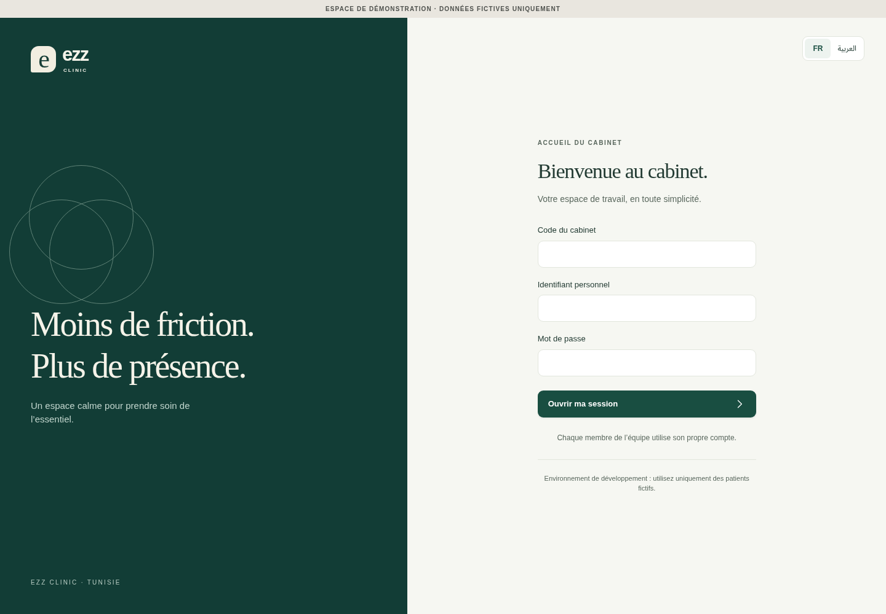
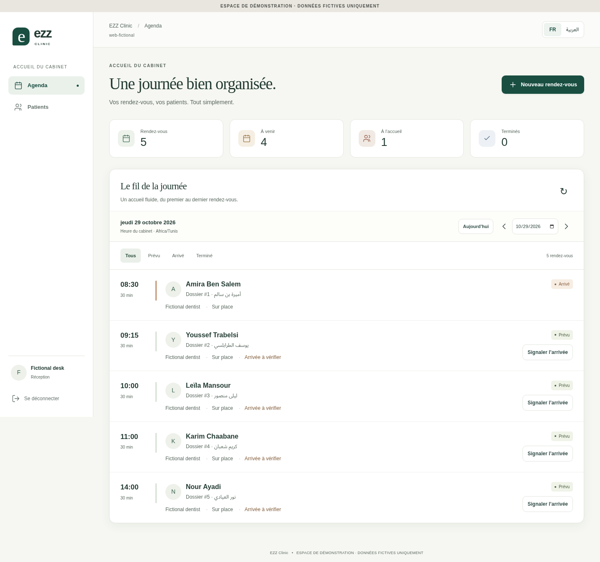
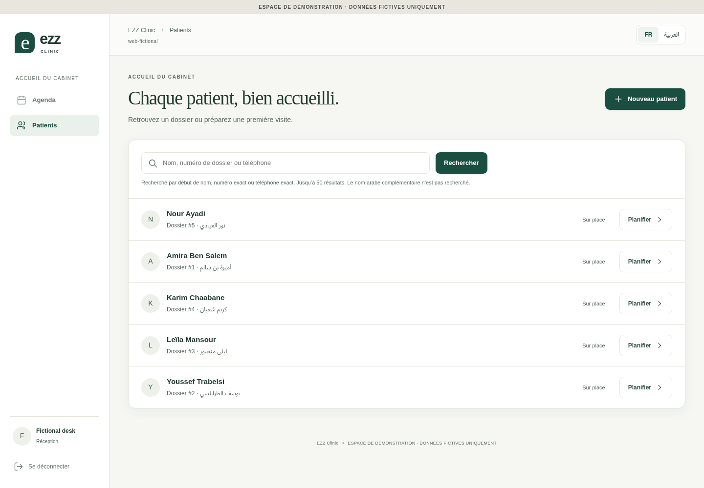
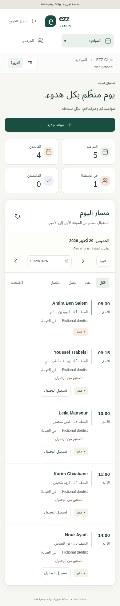
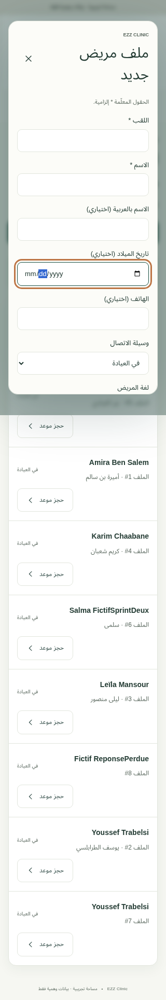

# Sprint 2 — first working frontend

Base: merged main `28520b8c627f74741f368a7de98f4962ad9e28d5`. New isolated branch:
`codex/sprint2-first-frontend`. Runtime implementation is in frontend/; the only
backend addition is a disposable fictional web fixture script. No backend source,
permission matrix, migrations or financial behaviour changed.

## Executed evidence

Node22.22.0, PostgreSQL16.15 and system Chromium. Tests exercise the **built React
app** through the same-origin proxy against a fresh migrated database and real
named staff sessions. No fabricated successful responses or undocumented endpoints.

- Frontend strict TypeScript/Vite production build: PASS.
- Frontend domain/contract tests: 4/4 PASS (clinic TZ/DST, frozen write intent,
  response projections/integer money, documented endpoint coverage).
- Real-API Playwright suite: **11/11 PASS, 0 fail, 0 skip, 0 flaky**. Final counts in [browser-results.json](sprint2/browser-results.json).
  Tests cover actual login/registration/search/scheduling/arrival, duplicate warning,
  committed-but-lost response replay, server session revocation, assistant403,
  server role downgrade403, cross-clinic404/search isolation, empty/loading/offline
  recovery, invalid credentials/required fields, overlap decision and Arabic keyboard
  dialog navigation. No retries configured to conceal flaky runs.
- Existing backend identity, day-board and generated API-contract suites: **36/36
  PASS, 0 fail, 0 skip**. This is a new execution; the Sprint1 full matrices are not
  relabelled as Sprint2 execution.
- Desktop agenda axe selected WCAG2A/AA/2.1AA/2.2AA rules: no violations in the final
  tested state. Arabic320px viewport and dialog containment were exercised. This is
  not a declaration of complete WCAG compliance, Tunisian linguistic validation or
  testing with real clinic staff. Mobile screenshot is390px; additional320px checks
  are automated. Ordinary browser zoom/reflow remains supported by responsive CSS.
- Final npm dependency audit: **0 findings** at execution time; not a security
  certification. Initial Vite/Zod high advisories were resolved using patched,
  explicitly locked versions7.3.7/4.6.7.

Commands and run steps: [frontend README](../../frontend/README.md). Complete local
browser JSON and initial failure evidence are preserved under [sprint2/](sprint2/).

## Failures found and corrected

1. First browser startup was blocked by mismatched transitive Playwright types;
   overrides pin Playwright/core to1.56.1 consistently with @playwright/test.
2. Initial8-test run:6 passed,2 failed. Axe found muted foreground contrast4.27–4.43
   and badge4.45 versus4.5 required; tokens were darkened. Modal Escape failed to
   restore opener focus; explicit restoration added. No assertions removed.
3. Expanded11-test run found an exact-label selector ambiguity for the practitioner
   select; it now has an explicit accessible label. Repeated Tab testing exposed a
   focus escape at the modal boundary; explicit boundary wrapping retains focus
   until Escape/Close. Initial JSON evidence remains alongside final results.
4. Build emits upstream Zod pure-comment annotation warnings; Vite removes those
   comments and succeeds. No runtime error was observed in the screenshot browser
   flow. npm's environment colour warnings are nonfunctional runner messages.

## Real application screenshots

All images below were captured by Chromium from real fictional API data in the
browser tests, not generated designs. The screenshots include the fictional-data
banner. Date and numbers come from the test clinic, not a hard-coded screen.

### Staff login

### Receptionist agenda

### Patient directory

### Arabic mobile agenda

### Arabic patient registration

## Review handoff and explicit limits

GPT: review the actual responsive visual design, copy and receptionist flow; native
French/Arabic clinical/admin terminology still needs qualified validation. Muse:
review token lifecycle/stale response handling,401/403 cache removal, immutable
write-intent retries, tenant separation and the production CSP/proxy boundary.

Existing backend limitations remain visible: no receptionist-wide practitioner
lookup, no search of the optional extra Arabic-name field, role language not saved
per user, and the known scheduling conflict concurrency risk. No permission was
silently expanded to hide these gaps. No clinical/checkout/owner screen is presented
as functional in this slice. No deployment, merge or real patient data authorised.

## GPT review follow-up (G-S2-001)

Continued on PR43 after GPT README commit f24467d69651d87df4f98d1e41e67251120aa0a0.
Reproduced malformed authenticated401: callback count0 instead of1 (RED log
`sprint2/review-auth-red.log`). Minimal API fix expires authenticated sessions on
401 JSON parse failure; parsable REAUTH_REQUIRED remains exempt. Non401 GET parse
failures and403 preserve auth; non401 POST parse failures retain NETWORK/uncertain
write semantics. No backend permission/source changes.

Executed follow-up: **7/7 frontend regressions**, strict frontend build, and
**13/13 real-API Chromium tests**, zero fail/skip/flaky. Browser tests load a real
staff session/patient board before injecting malformed GET/POST401 transport
responses; login replaces all patient rows/dialogs. Existing lost-response replay
and real403/revocation checks remain. Duplicate and overlap warnings now proceed
through explicit human confirmation to real successful writes (duplicate directory
count2, overlap POST201 with explicit allowOverlap).

Arabic320px registration checks retain keyboard focus, scroll the submit control
into view, submit via Enter and verify the dialog closes after actual registration.
Selected mobile-dialog axe rules report no violations. Native language/user
validation remains external; no blanket accessibility approval. Updated mobile
registration capture and screenshot hashes are committed. Raw original11-test
evidence is historical; browser-results.json now records the13-test follow-up.

CI results must be checked on the final pushed head, not inherited from cfc0d3d.
No merge/deploy; independent final-head Muse review remains required.
